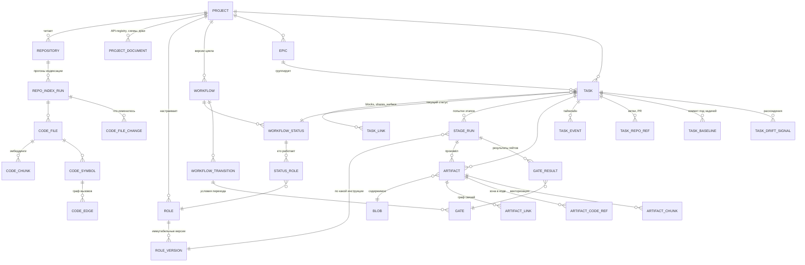
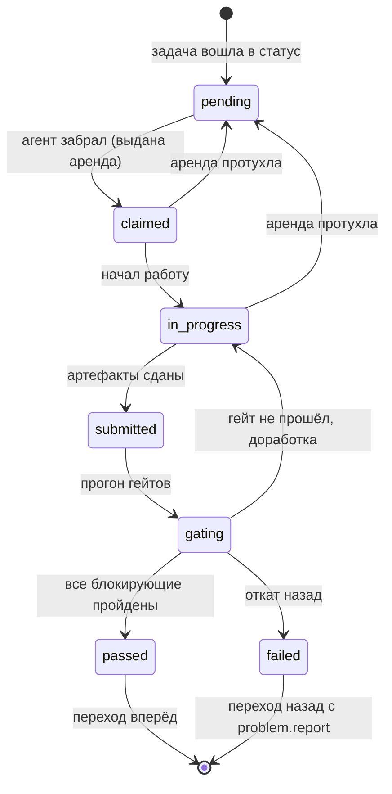
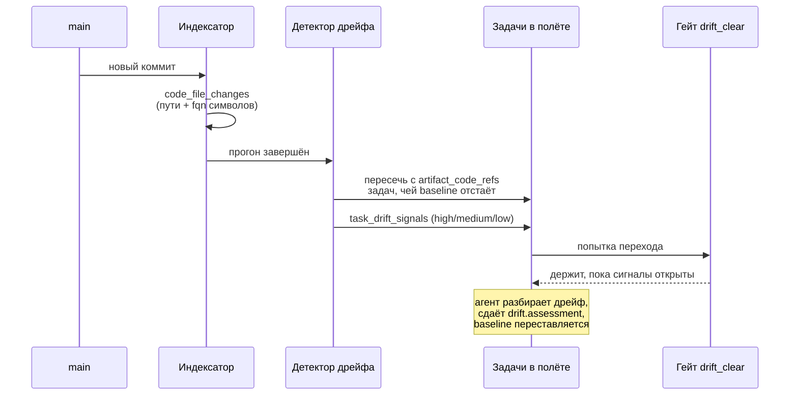
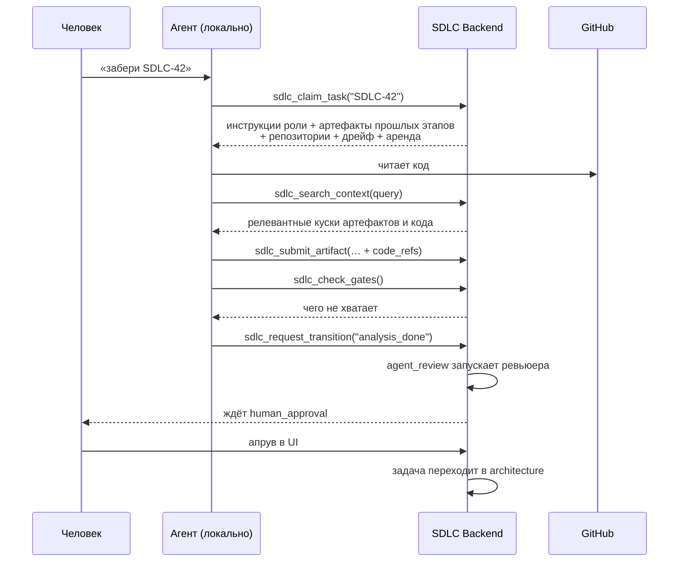

# SDLC Pipeline — архитектура

Статус: черновик к ревью. Код ещё не написан; зафиксированы модель домена, схема БД
и контракт взаимодействия с локальными агентами.

## 1. Что строим

Система ведёт задачу по кастомному циклу разработки. На каждом статусе работает
агент в роли специалиста (аналитик, архитектор, разработчик, ревьюер, QA), забирая
задачу со своей локальной машины. Переход на следующий статус закрыт гейтами:
пока не сданы нужные артефакты, не прошла перепроверка и не поставлен апрув —
задача не двигается. При найденной проблеме задача уходит назад вместе с
описанием проблемы. Все результаты работы копятся в задаче и становятся входом
для следующих этапов.

Ключевое отличие от таск-трекера: статусы, роли и гейты — данные, а не код.
Проект настраивает свой цикл сам. Второе отличие — система знает, что кодовая
база под задачами продолжает двигаться, пока задачи идут по циклу (см. §6).

## 2. Принятые решения

| Решение | Почему |
|---|---|
| Гейты висят на **переходе**, а не на статусе | Из одного статуса «вперёд» и «назад» требуют принципиально разного. Откат — это обычный переход с гейтом «приложи описание проблемы» |
| Роли **версионируются**, `stage_run` ссылается на версию | Правка роли не переписывает историю уже пройденных этапов. Понятно, по какой инструкции агент работал полгода назад |
| Один `stage_run` на **попытку**, а не на статус | Задача может пройти аналитику дважды. Обе попытки видны, вторая знает, из-за чего вернулась |
| Артефакты **иммутабельны**, содержимое — в контент-адресуемых `blobs` | Правка = новая версия через `supersedes_id`. Одинаковые вложения хранятся один раз |
| Код изменений живёт в **PR**, а не в артефакте | Дифф большой, быстро протухает и уже версионируется гитом. Артефактом становится разбор изменений, а сам PR привязан через `task_repo_refs` и проверяется гейтом `repo_ref_required` |
| **Дрейф** ловится сравнением зоны задачи с изменениями в main | Задачи идут параллельно, main двигается. Без этого задача доезжает до разработки с аналитикой, сделанной по коду, которого уже нет |
| Внутри задачи **нет параллельных этапов** | Фича, требующая работы на фронте и на бэке — это две задачи одного эпика со связью `blocks`, а не расщеплённый `stage_run` |
| Аренда (`lease`) на захваченной задаче | Агент локальный и может умереть, не отпустив задачу. Воркер возвращает протухшие |
| Акторы (`principals`) заложены сразу, аутентификация — потом | Все аудит-поля уже ссылаются на актора. Включение auth в фазе 2 = один резолвер в middleware, без миграции данных |
| MCP как основной канал для агента | Роль и контекст приезжают динамически в ответ на `claim`. Ничего не нужно синхронизировать в локальный репозиторий |

## 3. Модель домена



### Проект
Продукт целиком: микросервисы, фронтенд, привязанные GitHub-репозитории
(пока только на чтение), проектные материалы вне задач — API-registry,
блок-схемы взаимодействия, глоссарий. Плюс собственные роли, свой цикл и задачи.

### Роль
Описание поведения специалиста, а не набор прав. Версия роли (`role_versions`)
несёт:

- `instructions` — markdown: что делает, что проверяет, чего не делает;
- `input_kinds` — артефакты каких предыдущих этапов подать на вход;
- `output_contract` — что обязан произвести, с опциональной JSON Schema;
- `tool_policy`, `model_hint`, `repo_scope`, `context_budget` — рамки работы агента.

`output_contract` — то место, где роль перестаёт быть просто промптом: гейт
`artifacts_required` проверяет её механически.

### Задача и эпик
Задача — ключ вида `SDLC-42`, текущий статус, ссылка на внешний тикет (Jira) в
`external_ref`. Эпик группирует задачи одной бизнес-фичи; поскольку внутри задачи
параллельных этапов нет, разбиение «бэкенд отдельно, фронтенд отдельно» делается
двумя задачами эпика со связью `blocks` в `task_links`.

## 4. Жизненный цикл этапа



Аренда: `claim` выдаёт `lease_expires_at`, агент продлевает её heartbeat'ом.
Фоновый воркер возвращает в `pending` всё, у чего аренда истекла, и пишет
событие `lease.expired`.

## 5. Гейты

Восемь типов покрывают всё, что описано в постановке:

| Тип | Что проверяет | Конфиг |
|---|---|---|
| `artifacts_required` | Сданы артефакты нужных `kind` | `{"kinds":["analysis.brief", …]}` |
| `schema_validation` | Артефакт валиден и содержит ожидаемое | `{"artifact_kind":"review.verdict","expect":{"verdict":"pass"}}` |
| `checklist` | Отмечены обязательные пункты | `{"items":[{"id":"…","text":"…","required":true}]}` |
| `human_approval` | Живой апрув в UI | `{"min_approvals":1}` |
| `agent_review` | **Перепроверка другой ролью** | `{"reviewer_role_key":"reviewer","artifact_kind":"review.verdict","pass_on":"pass"}` |
| `external_check` | CI, вебхук, внешняя система | `{"provider":"github_checks","required_conclusion":"success"}` |
| `repo_ref_required` | К задаче привязан открытый PR | `{"ref_type":"pull_request","min_count":1,"require_open":true}` |
| `drift_clear` | Нет открытых расхождений с main и пересечений с другими задачами | `{"min_severity":"medium"}` |

`agent_review` — это и есть «перепроверка»: движок создаёт вложенный `stage_run`
для роли-ревьюера на том же статусе, ревьюер получает результат исполнителя как
вход и сдаёт `review.verdict`. Исполнитель и ревьюер — разные роли, поэтому
проверка не сводится к «агент проверяет сам себя».

Гейт с `blocking = false` фиксирует результат, но не держит переход — годится
для метрик и мягких правил.

## 6. Дрейф кодовой базы

Задачи идут по циклу параллельно, а main продолжает двигаться. Задача, чья
аналитика сделана на коммите X, может к моменту разработки опираться на код,
которого уже нет. Отдельный случай — две задачи в полёте, объявившие своей зоной
изменений одни и те же файлы: конфликт возникнет не в git, а в замысле, и
проявится тем позже, чем дороже его чинить.

Механизм состоит из четырёх частей и не требует особой машинерии — блокирует
движение обычный гейт.

**Базовая линия.** У задачи есть коммит, на котором построены её текущие
артефакты (`task_baselines`, отдельно на каждый репозиторий и ветку). Ставится
при первом захвате, переставляется, когда дрейф разобран.

**Зона задачи.** Агент, сдавая артефакт, объявляет, какого кода тот касается
(`artifact_code_refs`): `reads` — опирается, `modifies` — собирается менять,
`depends_on` — сломается, если сломается контракт. Это дублирует
`artifact_links.target_uri` намеренно: пересечение с изменениями main должно быть
индексируемым джойном, а не разбором строк URI на каждом прогоне.

**Изменения.** Индексатор при каждом прогоне отслеживаемой ветки пишет, что
изменилось относительно родительского прогона, включая `fqn` затронутых символов
(`code_file_changes`).

**Детектор.** Воркер после индексации пересекает изменения с зонами задач в
полёте и заводит сигнал (`task_drift_signals`). Уровень:

- `high` — изменился именно тот символ, на который у задачи прямая ссылка;
- `medium` — изменился файл, который задача собирается менять или от контракта которого зависит;
- `low` — изменился файл, который задача только читала.

Второй запрос детектора ловит пересечения задач: две задачи в полёте с
`ref_kind='modifies'` на одном файле получают по сигналу `task_overlap` и связь
`shares_surface` в `task_links`.



Порог у гейта настраивается на каждом переходе: в демо-цикле аналитику двигают
только расхождения уровня `high`, архитектуру — от `medium`, а разработку держит
любой открытый сигнал, включая пересечение с соседней задачей. Разрешение сигнала
— это либо разбор с обоснованием (`drift.assessment` как
`resolution_artifact_id`), либо явное `dismissed`. Если разбор показал, что
выводы этапа сломались, задача уходит назад обычным `reject`-переходом.

Референсная реализация обоих запросов детектора и проверки гейта —
[drift_detection.sql](drift_detection.sql), сценарий для проверки —
[migrations/seed/drift_demo.sql](../migrations/seed/drift_demo.sql).

## 7. Как работает агент

Локальный агент (Claude Code) подключается к MCP-серверу бэкенда, привязанному к
проекту. Полный контракт — в [MCP_CONTRACT.md](MCP_CONTRACT.md). Схема прохода:



Инструкция роли не лежит в репозитории — она приезжает в ответе на `claim`.
Правка роли в UI действует со следующего захвата, синхронизировать нечего.
Тонкий CLI `sdlc` даёт те же операции для CI и не-MCP клиентов.

## 8. Хранение и поиск

Объём растёт по трём осям: артефакты задач, содержимое репозиториев, эмбеддинги.

**Артефакты.** Содержимое вынесено в `blobs` с адресацией по sha256. Мелкое
лежит inline в `bytea`, крупное уходит в объектное хранилище по `external_uri`
— интерфейс `BlobStore` в Go скрывает разницу. Дедупликация бесплатна:
один и тот же документ, приложенный на трёх этапах, хранится один раз.

**Поиск по истории решений.** `artifact_chunks` с `vector(1024)` и HNSW-индексом.
Денормализованные `project_id` и `task_id` дают дешёвую фильтрацию до векторного
поиска.

**Эмбеддинги.** Voyage `voyage-code-3`, размерность 1024 — модель, которую
Anthropic рекомендует для кода. У Anthropic собственного embeddings API нет.
Размерность фиксируется на уровне колонки, поэтому смена модели на другую
размерность = миграция с новой колонкой и переиндексацией.

**Кодовая база.** Индексация серверная, по коммиту отслеживаемой ветки:
`repo_index_runs` → `code_files` → `code_chunks` (эмбеддинги) +
`code_symbols`/`code_edges` (символьный граф через tree-sitter) +
`code_file_changes` (дельта к родительскому прогону, вход детектора дрейфа).
Индекс на коммит неизменяем, новый коммит — новый прогон.

Граф намеренно живёт в реляционных таблицах, а не в графовой БД. `code_edges`
хранит `dst_fqn` всегда, а `dst_symbol_id` — только когда цель разрешилась:
это то, что позволяет держать связи **между репозиториями** проекта, которые
внутри одного репозитория не разрешаются. Обход на 2–3 шага делается рекурсивным
CTE; отдельная графовая БД оправдана только если понадобятся более глубокие
обходы, и это отдельное решение с миграцией, а не предпосылка.

## 9. Репозитории

Два независимых приватных репозитория:

```
sdlc-pipeline-backend/
  cmd/api/            HTTP + MCP сервер
  cmd/worker/         индексация, детектор дрейфа, протухшие аренды, эмбеддинги
  cmd/sdlc/           CLI для агентов и CI
  internal/
    config/
    httpapi/          роутер Gin, хендлеры, middleware (в т.ч. резолвер актора)
    mcp/              MCP-сервер: тулы поверх тех же сервисов
    domain/           сущности и бизнес-правила
    workflow/         движок: переходы, прогон гейтов, аренды
    drift/            базовые линии, детектор, разрешение сигналов
    store/postgres/   репозитории поверх pgx
    blobstore/        inline + S3-совместимый
    github/           чтение репозиториев
    indexer/          обход, чанкинг, tree-sitter, дельты
    embed/            Voyage
  migrations/
  docs/

sdlc-pipeline-frontend/
  src/
    pages/            Projects, Board, TaskDetail, Roles, WorkflowEditor, Repos
    features/         доменные модули
    api/              типизированный клиент
```

Общая документация живёт в бэкенде: он система записи для доменной модели.

## 10. Схема БД

Шесть миграций в `migrations/`, проверены на PostgreSQL 17 + pgvector
(up → down → up, сид, негативные тесты на ограничения, функциональный прогон
детектора дрейфа):

| Файл | Содержимое |
|---|---|
| `000001_core` | `principals`, `projects`, `agent_tokens`, `blobs`, `repositories`, `project_documents` |
| `000002_workflow` | `workflows`, `workflow_statuses`, `roles`, `role_versions`, `status_roles`, `workflow_transitions`, `gates` |
| `000003_tasks` | `epics`, `tasks`, `stage_runs`, `gate_results`, `task_repo_refs`, `task_events` |
| `000004_artifacts` | `artifacts`, `artifact_links` |
| `000005_knowledge` | `artifact_chunks`, `repo_index_runs`, `code_files`, `code_chunks`, `code_symbols`, `code_edges` |
| `000006_drift` | `code_file_changes`, `artifact_code_refs`, `task_baselines`, `task_drift_signals`, `task_links` |

Нетривиальные места:

- **Композитные FK.** У `workflow_statuses` есть `UNIQUE (workflow_id, id)`,
  поэтому `tasks (workflow_id, status_id)` ссылается на неё составным ключом.
  База физически не даёт поставить задаче статус из чужого цикла.
- **Частичные уникальные индексы** держат инварианты «один активный workflow на
  проект», «один начальный статус», «одна основная роль на статус».
- **`task_drift_signals_open_uniq`** — частичный уникальный индекс по
  `(task_id, kind, to_commit, related_task_id)` среди незакрытых сигналов.
  Детектор идемпотентен: повторный прогон не плодит дубли.
- **`workflow_statuses.position`** уникален и `DEFERRABLE INITIALLY DEFERRED` —
  переупорядочивание статусов проходит одной транзакцией без временных дырок.
- **`workflow_transitions.from_status_id` = NULL** означает «из любого статуса»
  (так устроен `cancel`).
- **`stage_runs_expiring_leases`** — частичный индекс под воркер, возвращающий
  задачи с протухшей арендой.

Запуск:

```bash
docker compose up -d
for f in migrations/*.up.sql; do
  docker exec -i sdlc-postgres psql -v ON_ERROR_STOP=1 -U sdlc -d sdlc < "$f"
done
docker exec -i sdlc-postgres psql -U sdlc -d sdlc < migrations/seed/default_workflow.sql
docker exec -i sdlc-postgres psql -U sdlc -d sdlc < migrations/seed/drift_demo.sql   # опционально
```

Сид разворачивает рабочий пример: цикл `new → analysis → architecture →
development → code_review → qa → done`, пять ролей с инструкциями и контрактами,
одиннадцать переходов (включая четыре отката), гейты на каждом и эпик с двумя
задачами — бэкендной и фронтендной — связанными `blocks`.

## 11. Аутентификация

Фаза 1 идёт без аутентификации: middleware резолвит актора из заголовка
`X-SDLC-Actor`, создавая `principal` при первом обращении. Всё остальное уже
готово к фазе 2 — `principals`, `agent_tokens`, и все аудит-поля
(`claimed_by`, `approved_by`, `decided_by`, `resolved_by`,
`task_events.actor_id`) ссылаются на принципала, а не на строку. Фаза 2 =
заменить резолвер и включить проверку токенов.

Единственное, о чём стоит помнить: пока auth нет, гейт `human_approval`
формально проходит от любого, кто дёрнул ручку. Для продакшена это блокер, для
отладки цикла — нет.

## 12. План по фазам

**Фаза 1 — ядро цикла.** Go + Gin + pgx, REST по проектам/ролям/циклам/задачам,
движок переходов с гейтами `artifacts_required`, `checklist`, `human_approval`.
Артефакты inline в blobs. Фронтенд: доска, карточка задачи с таймлайном и
артефактами, редактор ролей и цикла.

**Фаза 2 — агенты.** MCP-сервер, аренды и heartbeat, воркер протухших аренд,
CLI `sdlc`. Гейты `agent_review`, `schema_validation`, `repo_ref_required`.
Сквозной проход задачи живыми агентами.

**Фаза 3 — знание о проекте и дрейф.** Чтение GitHub, индексация репозиториев,
`code_file_changes`, эмбеддинги Voyage, `sdlc_search_context`. Детектор дрейфа,
гейт `drift_clear`, гейт `external_check` поверх GitHub Checks. Это фаза, после
которой параллельная работа над несколькими задачами становится безопасной.

**Фаза 4 — масштаб.** Символьный граф через tree-sitter (поднимает точность
дрейфа с уровня файлов до уровня символов), вынос blobs в объектное хранилище,
аутентификация и права, метрики цикла — где задачи застревают, какие гейты чаще
всего валятся, сколько задач разворачивает дрейф.

## 13. Что осталось открытым

1. **Разрешение символов при индексации.** Пока `code_file_changes.changed_symbols`
   заполняется tree-sitter'ом только для языков, для которых написан extractor.
   Для остальных дрейф деградирует до уровня файлов — это работает, но грубее.
   Порядок языков задать к фазе 3.
2. **Сколько прогонов индексации хранить.** Индекс на коммит неизменяем, значит
   растёт линейно по коммитам. Нужна политика вычистки старых прогонов, у которых
   не осталось ссылающихся базовых линий. Не блокирует старт.
3. **Автоматический откат при `high`-дрейфе.** Сейчас сигнал только держит гейт,
   а решение принимает человек или агент. Возможно, для `high` стоит сразу
   двигать задачу назад. Проверить на реальных данных, прежде чем автоматизировать.
